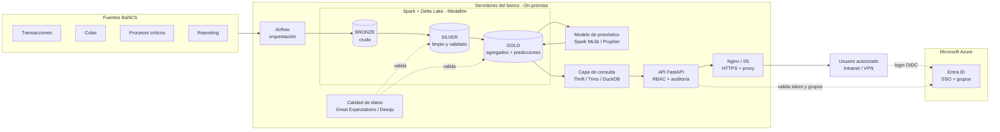
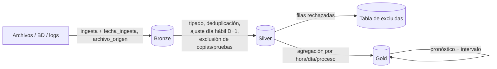
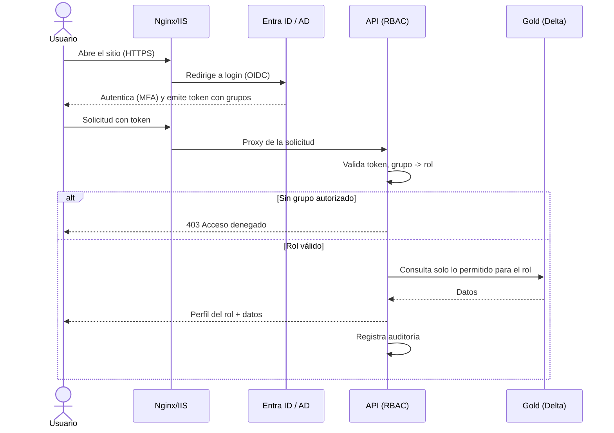
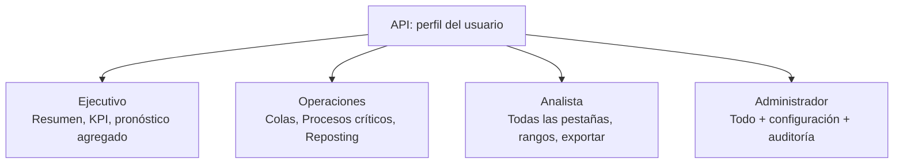
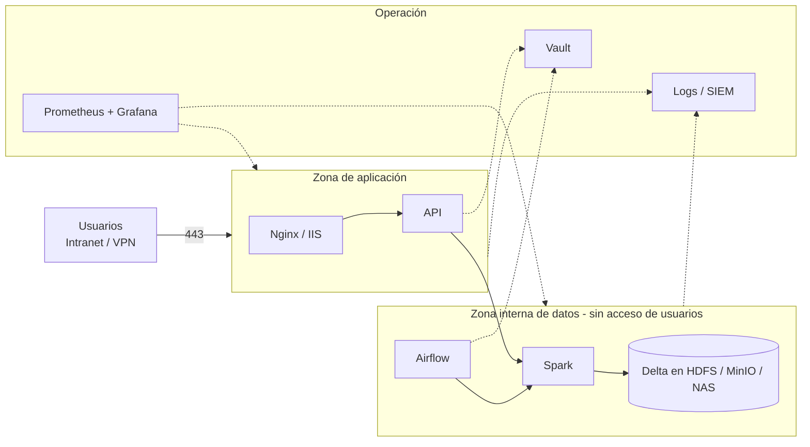

# Diseño de arquitectura – BaNCS Forecast

Diagramas en Mermaid (se visualizan en VS Code con la vista previa de Markdown, en GitHub y en Azure DevOps). Descripción de cada componente en [ARQUITECTURA.md](./ARQUITECTURA.md).

## 1. Arquitectura general



## 2. Flujo del medallón



## 3. Autenticación y autorización por rol



## 4. Pantallas por rol



## 5. Zonas de red



## 6. Estructura de repositorio sugerida

```
DayTransactionsPredictor/
├─ ARQUITECTURA.md
├─ DISENO_ARQUITECTURA.md
├─ dashboard/            # frontend (consume la API)
├─ api/                  # FastAPI: auth, RBAC, endpoints, auditoría
├─ spark/
│  ├─ bronze/            # ingesta
│  ├─ silver/            # limpieza y reglas
│  ├─ gold/              # agregados
│  └─ forecast/          # modelo de pronóstico
├─ airflow/dags/         # un DAG por dominio
├─ quality/              # expectativas de calidad
├─ deploy/               # nginx/IIS, systemd/Docker, CI/CD
└─ tests/
```
